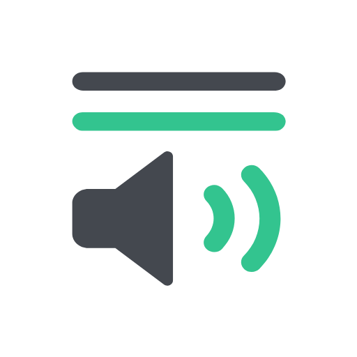
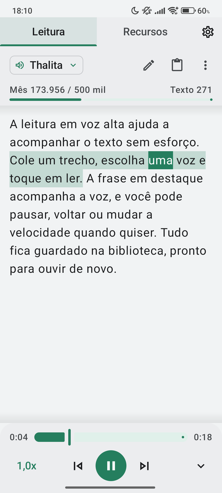
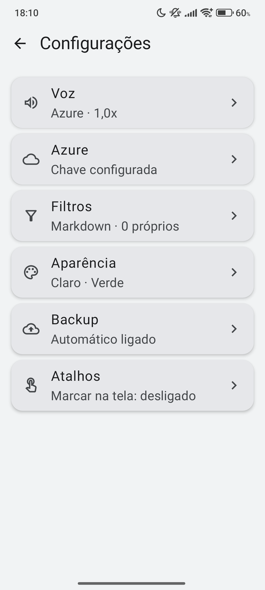
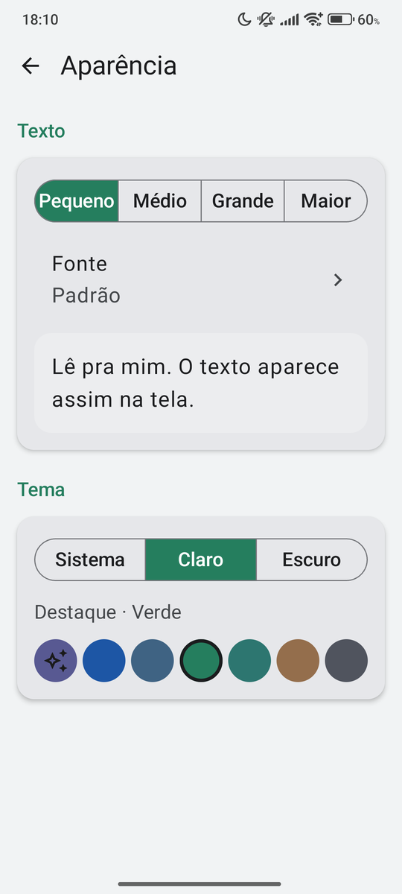

# Lê Pra Mim

**Um leitor de texto em voz alta para Android** 🔊

Pensado para quem tem dislexia ou simplesmente prefere ouvir a ler.

  

---

## ✨ O que ele faz

Copie, selecione ou aponte para qualquer texto do celular e ouça. Sem precisar abrir nada.

### 📖 Maneiras de ler um texto

| Como | O que acontece |
|------|----------------|
| ✂️ **Menu do texto** | Selecione um texto em qualquer app e toque em **Ler**. Também funciona pelo Compartilhar. |
| ⚡ **Botão Ler na Central de Controle** | Lê o último texto copiado. Texto novo troca e lê; o mesmo texto que está tocando para a leitura. |
| 📋 **Ao abrir o app** | Se houver um texto novo copiado, a leitura começa sozinha. |
| 🖼️ **Marcar na tela** | Pelo gesto ou botão de acessibilidade, marque um trecho da tela e ele é lido, mesmo que o texto não possa ser selecionado. O reconhecimento das letras é feito no próprio aparelho, sem internet. |
| 📂 **Carregar** | Abre arquivos **TXT**, **Word (.docx)** e **PDF**. PDF com texto sai direto; PDF de imagem (escaneado) é lido por reconhecimento de texto. Também chegam pelo Compartilhar, junto com imagens. |
| 📷 **Digitalizar** | Tire uma foto ou escolha uma imagem, ajuste os cantos do documento e o texto é reconhecido no aparelho. |
| 🌐 **Link da web** | Cole o endereço de uma página: o app baixa e guarda o texto principal dela. |
| ✍️ **Escrever texto** | Janela própria com título e texto, que vai para a biblioteca. |

> 🔒 Textos copiados de gerenciadores de senhas (marcados como sensíveis pelo Android) não são lidos nem mostrados.

### 🎧 Durante a leitura

- 🟩 Frase lida marcada e a **palavra atual** em destaque forte (na Azure a palavra é estimada), com o texto rolando sozinho.
- 👆 **Dois toques** num parágrafo leem a partir dali, e a frase sobe para o topo.
- 📏 **Barra de rolagem** na borda direita, que se arrasta para ir longe no texto.
- ✏️ Dá para **editar** o texto (toque no lápis), colar, copiar e limpar. O texto fica salvo até você limpar.
- ⏯️ Player compacto e **recolhível**: **play, pausa, voltar e avançar**, barra que se arrasta, tempo decorrido e total, e a **velocidade** no próprio botão.
- 🔔 A leitura continua em segundo plano, num **player na notificação**.

## 📚 Biblioteca

- O que você escreve, carrega, digitaliza ou baixa de um link fica guardado na aba **Recursos**.
- Toque num item para abrir na Leitura. Tem **busca**, **renomear** e **excluir**.
- Os textos ficam só no aparelho, em arquivos simples.

## 💾 Backup

- **Fazer backup** salva a biblioteca num arquivo, onde você quiser, como o Google Drive. **Restaurar backup** traz de volta sem duplicar o que já existe.
- **Backup automático:** Desligado, Diário ou Semanal, numa pasta que você escolhe (Google Drive ou dispositivo), atualizando sempre o mesmo arquivo.
- Só os textos vão no backup, sem chaves nem preferências.

## 🗣️ Vozes

- 📱 **Neste aparelho:** usa o motor de voz instalado (por exemplo, Vocalizer).
- ☁️ **Azure:** vozes neurais em português do Brasil, com a sua própria chave do Azure Speech. Inclui:
  - ⭐ vozes **favoritas**;
  - 📊 consumo do mês, inclusive o do portal da Azure;
  - 🎵 **Exportar em MP3**.
- 🔁 Se a Azure falhar, a leitura continua com a voz do aparelho.

> 🔑 A chave fica **só no seu aparelho**. Quando a voz da Azure está ligada, o texto lido é enviado ao serviço da Microsoft para virar áudio.

## 🧹 Filtros

Para a leitura ficar limpa, sem mudar o texto da tela:

- 🔗 Links viram só o nome do site.
- 📝 Marcações de Markdown ignoradas.
- 🧩 Regras suas, com expressões regulares.

## 🎨 Aparência

- 🌗 Tema **Sistema, Claro ou Escuro**.
- ⚫ **Sete fundos escuros** à escolha: Preto, Vinho, Grafite, Petróleo, Marinho, Verde e Roxo.
- 🌈 **Seis cores de destaque** e a **Automática**, que acompanha o papel de parede (Android 12+).

## 📥 Instalar

1. Baixe o APK mais recente em **[Releases](https://github.com/wenesga/Le-Pra-Mim/releases/latest)**.
2. Abra o arquivo no celular e permita a instalação de fontes externas, se o Android pedir.
3. Se for usar o **Marcar na tela**, ligue o serviço em *Configurações → Acessibilidade*.

Requer **Android 11 ou mais novo**.

## 🛠️ Tecnologia

Kotlin · Jetpack Compose · Material 3 · DataStore · TextToSpeech · MediaSession · AccessibilityService · ML Kit (reconhecimento de texto e scanner de documento) · PDFBox · Azure Speech

## 🔐 Privacidade

- O reconhecimento de texto (OCR) acontece no aparelho.
- Nada é enviado a servidores, exceto o texto lido quando você escolhe a voz da **Azure** e as páginas que você pede no **Link da web**.
- O backup vai só para o local que você escolher, e leva apenas os textos.
- A chave da Azure e as credenciais ficam só no aparelho.

---

Feito com 💚 por [Wenes](https://github.com/wenesga)

